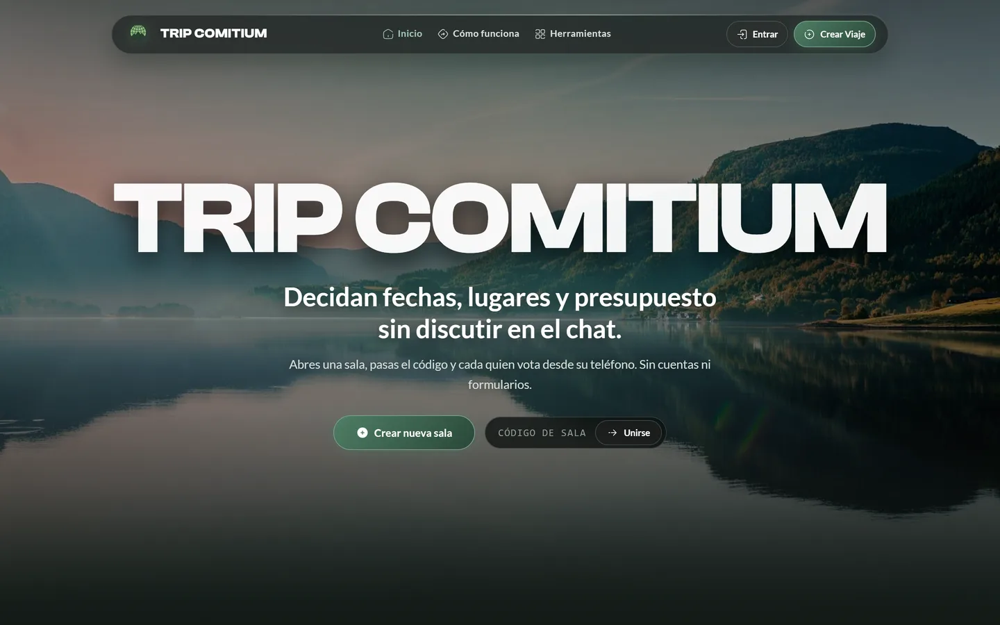
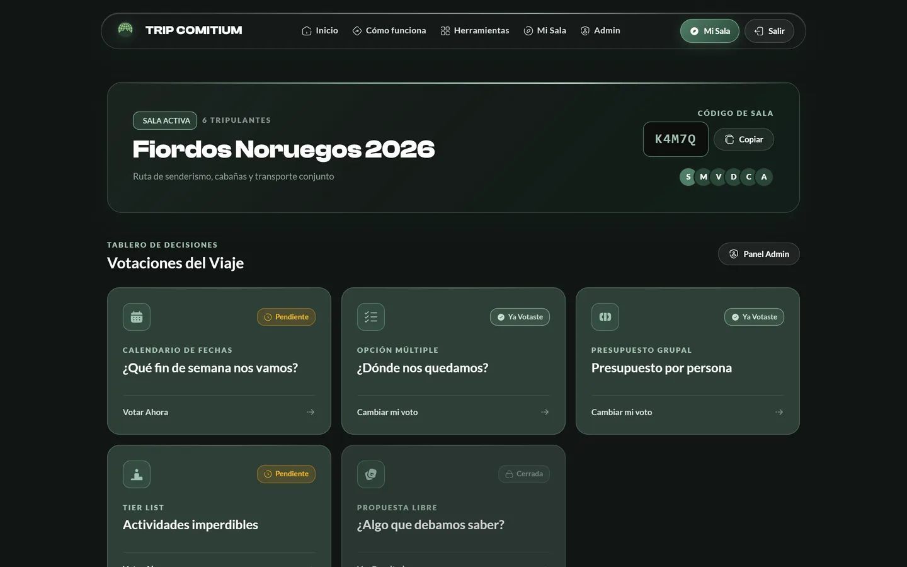
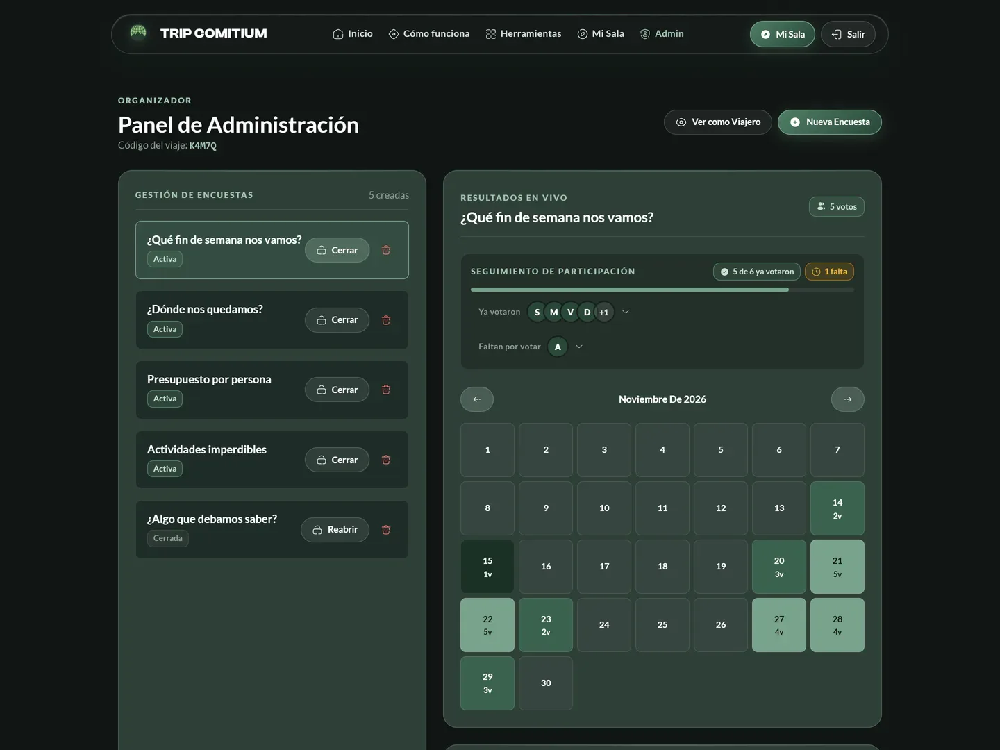
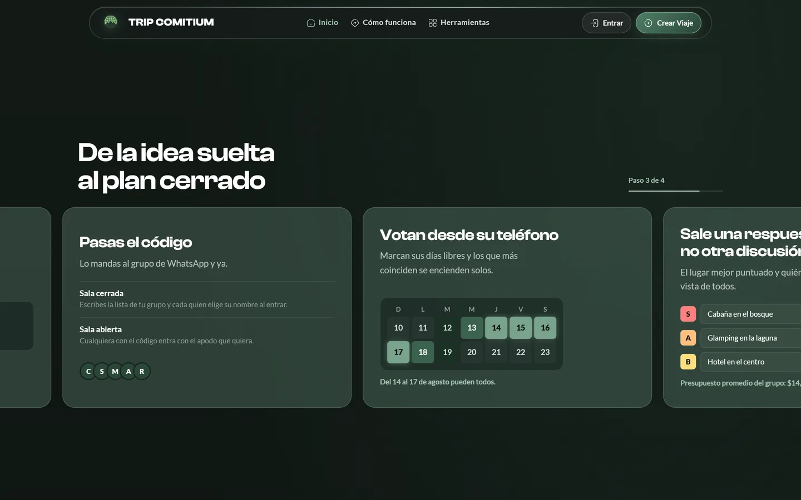
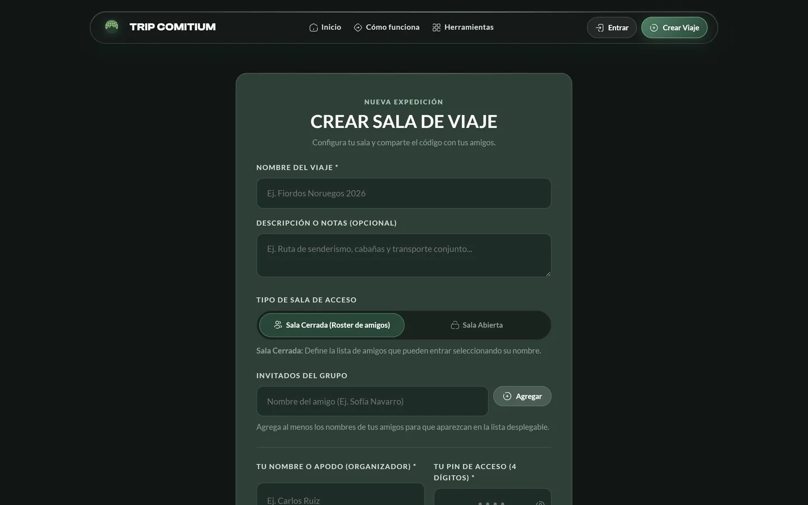
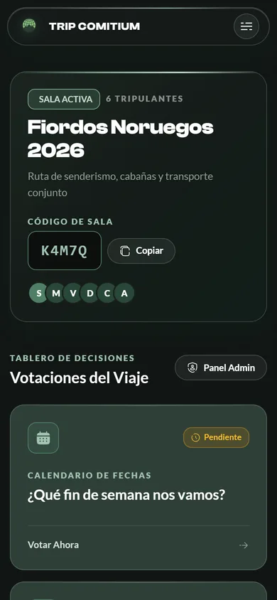
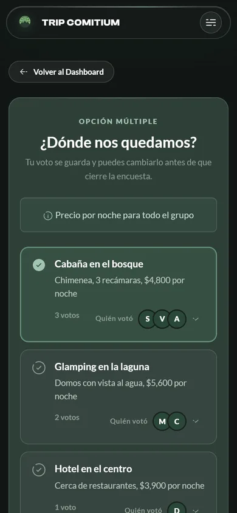
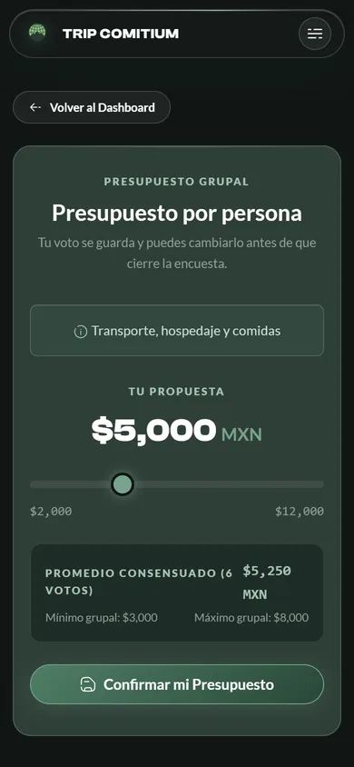
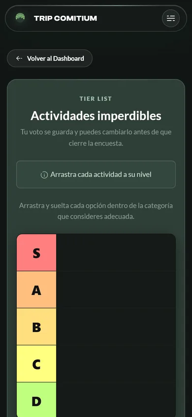
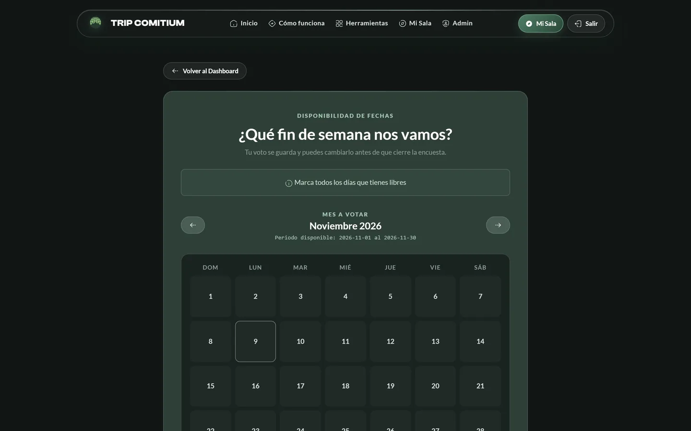

<div align="center">


# Trip Comitium · Frontend

**Decide dates, places and budget for a group trip without arguing in the chat.**

*Open a room, share a five-character code and everyone votes from their phone. No accounts, no forms.*

<a href="https://trip-comitium.netlify.app"></a>
<a href="https://github.com/NotJcao17/trip-comitium-backend"></a>

[](https://angular.dev)
[](https://www.typescriptlang.org)
[](https://getbootstrap.com)
[](https://sass-lang.com)
[](https://trip-comitium.netlify.app)

<br>



</div>

---

## What is Trip Comitium?

Planning a trip with friends usually means dozens of ideas lost in a group chat. **Trip Comitium**
(from the Latin *comitium*, the place where Romans gathered to vote) turns those decisions into
quick polls:

1. **The organizer opens a room** with the trip's name and gets a five-character code.
2. **They share the code** in the group chat.
3. **Everyone votes from their phone**: available dates, where to stay, how much to spend, which
   activities matter most.
4. **One answer comes out**: the days that work for most people light up on a calendar, options are
   ranked and the budget is averaged, in plain sight for everyone.

This repository is the **Angular client**. The REST API lives in
[trip-comitium-backend](https://github.com/NotJcao17/trip-comitium-backend). The interface is in
Spanish. It started as the final project of a Web Application Development course and kept growing
after that.

---

## 📸 Screenshots

<sub>The screens inside a room show a demo trip with fictional participants.</sub>

<div align="center">

&nbsp;


&nbsp;


<br><br>

&nbsp;
&nbsp;
&nbsp;


<br><br>



</div>

---

## ✨ Features

### Rooms without accounts
- 🔑 **Five-character room code** to join, plus a personal **4-digit PIN** so each person can get back
  to their votes from any device.
- 🔒 **Closed room**: the organizer writes the group's roster and each friend picks their name when
  entering. **Open room**: anyone with the code joins with any nickname.
- 🕘 **Recent trips** are remembered in the browser to reconnect with one tap.
- 📋 Copy the code in one click and see who is on board at a glance.

### Five kinds of polls

| Poll | What people do | What the group sees |
| :--- | :--- | :--- |
| 📅 **Dates** | Mark every free day in a range | A calendar heatmap with how many people can make each day, and who |
| ☑️ **Multiple choice** | Pick one option (with description and photos) | Votes per option and who voted for each |
| 💰 **Budget** | Move a slider (min, max and step in MXN) | Average, minimum and maximum of the group |
| 🏆 **Tier list** | Drag each option into S, A, B, C, D… | A ranking computed from everyone's tiers |
| 💬 **Free text** | Write a proposal or a note | Every response |

- 🖼️ Options can carry a **photo gallery** from direct image links (Postimages or ImgBB).
- 🙈 **Anonymous polls**: only the organizer can see who voted what.
- ✏️ Votes can be **changed** while the poll is open.

### Organizer panel
- ➕ Create polls of any type with a guided form and validation.
- 🔐 **Close, reopen or delete** polls.
- 📈 **Live results** of the selected poll with **participation tracking**: who already voted and
  who is still missing.
- 👥 **Roster management**: invite new members, reset someone's PIN or remove them.
- 👁️ "See as traveler" to check what the group sees.

### Design
- 🌲 Dark forest theme with liquid-glass surfaces, a full-screen hero and a scroll-driven "How it
  works" story.
- 📱 Responsive from phone to desktop; the voting screens are made for one-hand use.

---

## 🛠️ Tech Stack

| Layer | Technology |
| :--- | :--- |
| **Framework** | Angular 20 (standalone components, router guards, HTTP interceptor) |
| **Language** | TypeScript |
| **Styling** | SCSS + Bootstrap 5, Bootstrap Icons |
| **Drag and drop** | Angular CDK (tier list) |
| **Auth** | JWT stored in the browser and attached by `auth.interceptor.ts` |
| **Hosting** | Netlify |

---

## 🏗️ Project Structure

```
src/app/
├── pages/
│   ├── landing-page/        # Hero, how it works, tools, call to action
│   ├── create-trip/         # Create a room (closed roster or open)
│   ├── join-trip/           # Join with code + name + PIN, recent trips
│   ├── trip-dashboard/      # The trip's polls
│   ├── vote-page/           # Voting screen for one poll
│   └── admin-panel/         # Organizer panel
├── features/voting/
│   ├── date-selector/       # Calendar + heatmap
│   ├── standard-vote/       # Multiple choice and free text
│   ├── budget-slider/       # Budget slider
│   ├── tier-list-sort/      # Drag-and-drop tier list
│   ├── poll-creator/        # New poll form
│   ├── poll-stats-display/  # Results
│   └── participants-table/  # Roster management
├── components/              # navbar, footer, poll-card, option-gallery, voters-list, empty-state
├── services/                # auth, trip and poll services
├── guards/                  # authGuard, adminGuard
├── interceptors/            # Adds the JWT to every request
└── models/                  # Trip, Poll and Vote interfaces
```

---

## 🚀 Getting Started

### Prerequisites
- Node.js 20+ and the Angular CLI
- The [backend](https://github.com/NotJcao17/trip-comitium-backend) running locally on port 3000

### Setup

```bash
git clone https://github.com/NotJcao17/trip-comitium-frontend.git
cd trip-comitium-frontend
npm install
ng serve            # http://localhost:4200
```

`ng serve` uses `src/app/environments/environment.development.ts`, which points to
`http://localhost:3000/api`. The production build (`ng build`) uses `environment.ts`, which points to
the deployed backend.

---

<div align="center">
  Created by <b>Juan Carlos Orozco Nieto</b>
</div>
